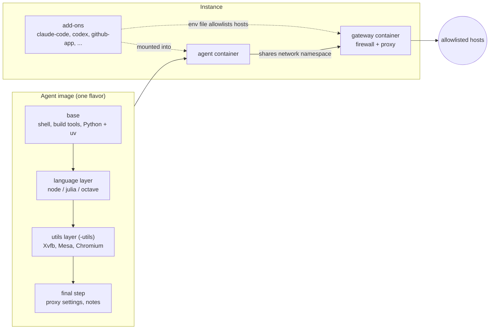

# Concepts

An instance of agent-sandbox is built from four kinds of parts:

- **[Images](images.md):** the agent container's image, a chain of layers chosen by the
  *flavor*. Headless core images and `-utils` variants with a display and Chromium.
- **[Gateway and network](gateway.md):** the sidecar that owns the network namespace,
  runs the firewall and the filtering proxy, and decides what gets out.
- **[Add-ons](addons.md):** per-instance features mounted into the containers at start:
  the coding agent itself, Git access, notifications, GPUs, clusters.
- **[Isolation and limits](isolation.md):** what the sandbox keeps the agent away from,
  and what it can't.
